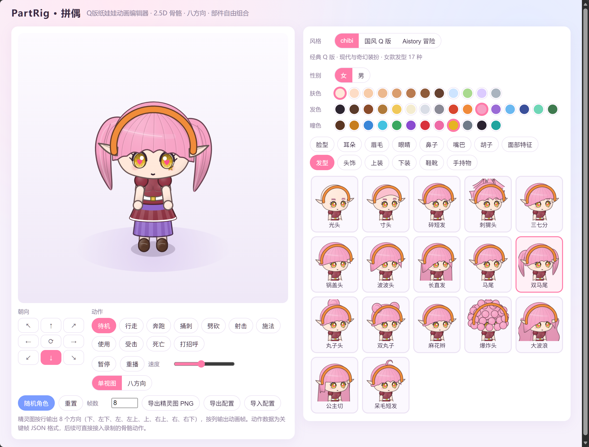

# PartRig · 拼偶

<p>
  <a href="./README.md">简体中文</a> · <a href="./README.en.md">English</a>
</p>

**PartRig（拼偶）** 是一个基于 TypeScript + Vite + Canvas 2D 的 Q 版纸娃娃动画编辑器：角色由矢量路径绘制、由 16 根骨骼驱动，支持八方向动画与透明 PNG 精灵图导出。零运行时依赖，开箱即用，适合独立游戏美术资源的预览与生产。

> **在线 Demo**：[https://partrig.onegame.ai](https://partrig.onegame.ai)

<p align="center">
  
</p>

## 特性

- **矢量部件 + 骨骼动画**：所有部件以 Canvas 路径绘制，由 16 根骨骼的关键帧驱动；2.5D 视角（俯仰投影），柔和明暗、细描边、虹膜纹理与衣料褶皱。
- **八方向动画**：下、左下、左、左上、上、右上、右、右下共 8 个朝向，任意动作实时切换。
- **三套风格**：`chibi`（Q 版）、`guofeng`（国风 Q 版）、`aistory`（冒险风）；男女角色各自保存编辑结果，可随时切换恢复。
- **海量部件组合**：国风男女各 14 个部位槽位（脸型、五官、发型、头饰、服装、手持物等），每槽位 12 款起，共 340+ 选项；支持肤色、发色、瞳色与服装染色。
- **精灵图导出**：一键导出透明 PNG——按行排列 8 方向、按列排列动画帧，文件名包含风格、性别、动作与帧数。
- **配置导入导出**：JSON 格式的角色配置，支持本地多档案保存、随机角色、配置导入导出；旧配置自动兼容。
- **零依赖**：无任何运行时依赖，构建产物极小。

## 快速开始

```sh
npm ci
npm run dev -- --host 127.0.0.1   # 开发服务器
npm test                          # 单元/回归测试
npm run build                     # 生产构建
```

要求 Node.js 18+。

## 使用说明

- 右侧面板选择风格（`chibi` / 国风 / Aistory 冒险），再选择性别与部位。
- **动作**：待机、挥手、挥砍等循环播放；**死亡**动作播放一次后保持倒地，可重播，导出的精灵图包含最终倒地帧。
- **朝向**：方向键盘切换 8 朝向，⟳ 按钮开启自动旋转。
- **导出精灵图**：帧数 2–24 可调；输出布局为 8 行（方向）× N 列（帧），透明背景。
- 配置保存在浏览器 `localStorage`，按「风格 + 性别」分档案；导出的 JSON 可在其他设备导入。
- 旧版本 JSON 配置缺失 `style` 字段时按 `chibi` 读取；非法部件 ID 自动安全回退。

### 精灵图布局

```
帧 →  0    1    2   ...  N-1
下    [●]  [●]  [●]      [●]
左下  [●]  [●]  [●]      [●]
...   ...
右上  [●]  [●]  [●]      [●]
```

单元格 192×192，可直接对接主流游戏引擎的精灵渲染器。

## 项目结构

| 模块 | 责任 |
| --- | --- |
| `src/parts/catalog.ts` | 风格注册、男女部位目录；`getCatalog(style, gender)` 统一查找 |
| `src/parts/guofeng-*.ts` | 国风五官、发髻冠饰、服饰、武器 |
| `src/parts/aistory*.ts` | Aistory 冒险部件、分束刘海、高马尾、旅行服和配饰 |
| `src/parts/ornaments.ts` | 云纹、莲花、梅花、竹叶等刺绣路径 |
| `src/parts/palettes.ts` | 肤色、发色、瞳色、服装染色色板 |
| `src/core/skeleton.ts` | 16 骨骼骨架定义 |
| `src/core/animation.ts` | 循环/单次采样与姿态混合 |
| `src/anim/clips.ts` | 骨骼关键帧动作；`loop: false` 表示单次动作 |
| `src/core/appearance.ts` | 配置验证和旧配置兼容 |
| `src/render/` | Canvas 绘制与相机投影 |
| `src/main.ts` | 编辑器 UI 与交互 |

## 测试

```sh
npm test                       # 核心回归测试
node tests/render-regression.mjs   # 渲染像素回归（八方向、4,752 帧）
node tests/browser.mjs         # 浏览器端到端验证（需 Playwright + Chromium）
node tests/visual-preview.mjs  # 生成动作/脸型视觉预览
```

浏览器测试为可选功能，不影响应用依赖。如 Playwright 安装在别处，可通过环境变量指定：

```powershell
$env:SPRITE_PLAYWRIGHT = '你的 Playwright 包绝对路径'  # Playwright 包位置
$env:SPRITE_URL = 'http://127.0.0.1:5173/'            # 开发服务地址
$env:SPRITE_STYLE = 'aistory'                          # 待验证风格（默认 guofeng）
node tests/browser.mjs
```

截图保存在被 Git 忽略的 `.shots/`，测试构建暂存在 `.test-build/`。

## 路线图

- [ ] 骨骼动作录制/导入（当前动作数据为关键帧 JSON，已预留接入口）
- [ ] 自定义部件包（外部 JSON 注册新风格）
- [ ] 更多导出尺寸与 Gif/WebP 动画导出

## 贡献

欢迎 Issue 与 PR！新增部件请遵循现有单引号、命名与路径绘制风格；提交前请运行 `npm test` 与 `npm run build`。

## License

[MIT](./LICENSE)（待添加）
